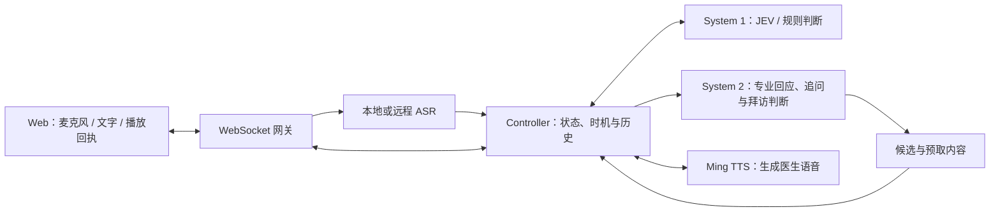

<a id="readme-top"></a>

<!-- PROJECT SHIELDS -->
[![TypeScript][typescript-shield]][typescript-url]
[![React][react-shield]][react-url]
[![Node.js][node-shield]][node-url]
[![Remotion][remotion-shield]][remotion-url]

<!-- PROJECT LOGO -->
<br />
<div align="center">
  <a href="https://github.com/ScH-CueX/CueX">
    
  </a>
  <h3 align="center">CueX</h3>
  <p align="center">
    <strong>让每一次临场应对，都有准备。</strong><br />
    从医药代表训练出发，练习听懂变化、调整回应。<br />
    AI + 医疗健康 · 记性好了一点
    <br /><br />
    <a href="docs/DEPLOYMENT.md"><strong>阅读部署指南 »</strong></a>
    <br /><br />
    <a href="#getting-started">启动体验</a>
    &middot;
    <a href="#media">视频与路演</a>
    &middot;
    <a href="https://github.com/ScH-CueX/CueX/issues">反馈问题 / 提出建议</a>
  </p>
</div>

<!-- TABLE OF CONTENTS -->
<details open>
  <summary>目录</summary>
  <ol>
    <li><a href="#about-the-project">项目介绍</a></li>
    <li><a href="#problem">调研、痛点与解决思路</a></li>
    <li><a href="#product">产品与使用方式</a></li>
    <li><a href="#business">商业路径</a></li>
    <li><a href="#architecture">代码架构与技术栈</a></li>
    <li><a href="#getting-started">快速开始</a></li>
    <li><a href="#deployment">通用部署</a></li>
    <li><a href="#media">视频与路演</a></li>
    <li><a href="#roadmap">未来规划</a></li>
    <li><a href="#contributing">开发与维护</a></li>
    <li><a href="#license">许可与素材</a></li>
    <li><a href="#contact">团队与联系</a></li>
    <li><a href="#acknowledgments">致谢</a></li>
  </ol>
</details>

<!-- ABOUT THE PROJECT -->
<a id="about-the-project"></a>
## 项目介绍

[![CueX 浅色诊室界面][product-screenshot]](docs/RUNNING.md)

**CueX 是一套面向临场沟通的 AI 演练系统，首个场景是医药代表拜访医生。**

代表可能已经背熟研究资料，但医生的追问会改变对话方向。CueX 希望训练的，是这一刻的连续动作：停下原稿、听懂关切、重新选择证据，再组织回应。

在一次练习里，AI 医生可以继续听、围绕尚未回答的问题追问，也可以收回已经准备好的追问。练习后，用户回到具体片段复盘，再尝试减少提示或改变提问时机的训练。

仓库包含 Web 前端、实时会话后端、共享 TypeScript 协议、Windows 语音服务、Remotion 产品视频和 open-slide 路演工程。

<p align="right">(<a href="#readme-top">返回顶部</a>)</p>

<a id="problem"></a>
## 调研、痛点与解决思路

我们的研究起点是公开资料与竞品案例。目前尚未开展真实客户访谈、试用或付费验证。

| 公开研究中的线索 | 我们聚焦的痛点 | CueX 的解决思路 |
| --- | --- | --- |
| ZS 的药企案例提到，人工角色扮演占用经理与同事时间。 | 有限的陪练资源难以支持频繁尝试。 | 提供可重复的 AI 演练，把人工辅导聚焦到具体片段。 |
| UMU 的医药拜访方案强调，医生会动态追问、打断和质疑。 | 会介绍资料，并不等于能在对话变化时调整回答。 | 根据当前关切判断继续听、追问或撤销，而非只要求讲完原稿。 |
| 现有 AI 陪练已覆盖角色模拟、动态提问和反馈。 | 训练还需要关注当下行动，以及减少提示后的独立应对。 | 区分候选与已说出的内容，结合最小提示、复盘与重练。 |

来源：[ZS 药企培训案例](https://www.zs.com/about/case-studies/enhancing-pharma-sales-rep-training-with-ai)、[UMU 医药客户拜访模拟](https://www.umu.cn/content/mo-ni-mian-dui-mian-yi-yao-ke-hu-bai-fang_5ee231)。这些是供应商公开资料，不是 CueX 自身的效果数据。完整依据与待验证假设见[研究记录](ppt/docs/research-basis.md)。

一个具体例子：代表还在介绍整体降压结果，医生却关心高龄、肾功能不佳的患者。继续照稿讲会偏离关切；先回应人群的证据范围，才是在练临场应对。CueX 不以“AI 医生”或“打断”本身宣称行业首创。

<a id="product"></a>
## 产品与使用方式

| 能力 | 用户能看到的行为 | 对应实现 |
| --- | --- | --- |
| 边听边判断 | 回应得当时继续听，持续偏离时准备追问。 | System 1、流式转写、关切进度 |
| 专业对话 | 结合医生关切和资料接话、澄清、纠错；代表记不清时给出查阅线索。 | System 2、医生档案、资料依据 |
| 并行准备 | 追问尚未说出时，系统已经准备好候选内容。 | System 2、候选生命周期 |
| 输出前复核 | 用户主动补答后，不再必要的追问会撤销。 | Controller、取消与播放回执 |
| 分级辅助 | 全量提示、四周光色轻提示、撤除辅助。 | `ClinicalScaffoldingHUD`、`CueEdgeLight` |
| 复盘与重练 | 查看医生是否愿意继续了解、理由及下一步，结合实际发言再练一次。 | 拜访判断、实时记录、关键片段与重练 |
| 可打断语音 | 用户开始回应时，停止当前医生音频。 | 浏览器音频管道、ASR、Ming TTS |

场景合成与团队经验库已接入后端，配置与使用见 [场景库说明](docs/SCENARIO_LIBRARY.md)。

### 三种体验方式

- **演示回放**：只启动前端即可体验 68 秒可拖动片段、辅助切换和示例复盘；不调用在线模型。
- **实时联调**：启动前后端，使用替身引擎检查连接、输入、候选和结束流程；默认配置无需模型凭据。
- **真实模型演练**：配置 System 1 / System 2、ASR 和 Ming TTS 后，使用语音或文字进行实时交互。

当前的 ANSHU-3 是虚构训练资料，示例数字不代表真实临床证据。示例复盘不是实时模型性能或学习效果基准。服务端已支持拜访记录与同一连接上的重练；完整的长期学习档案、企业后台和多租户能力仍在规划中。

<p align="right">(<a href="#readme-top">返回顶部</a>)</p>

<a id="business"></a>
## 商业路径

**先验证医药代表培训这一具体场景，再探索可持续的团队服务。**

| 项目 | 当前设想 |
| --- | --- |
| 首个目标用户 | 已掌握基础资料、准备独立拜访医生的新人医药代表 |
| 潜在付费方 | 药企的培训部门、销售赋能团队 |
| 初始交付 | 围绕企业已审定资料配置训练场景，提供反复演练与关键片段复盘 |
| 收费方向 | 团队订阅，以及场景内容配置与维护服务 |
| 进入方式 | 小组试点 → 评估训练价值与使用意愿 → 再验证团队订阅 |
| 试点关注 | 回应相关性、减少提示后的独立完成度、教练投入与复练使用情况 |

以上是待验证的商业计划，尚无客户、合同、收入、定价或效果数据。试点应先回答“谁愿意持续使用、为哪部分价值付费”，再决定功能和交付范围。

### X 的四个端点

| 拓展方向 | 可以练习的对话 | 阶段 |
| --- | --- | --- |
| 销售 | 医药代表拜访、客户顾虑与异议回应 | 从医药代表场景起步 |
| 社交 | 陌生人破冰、表达观点 | 拓展愿景 |
| 演讲 | 即席问答、被追问时重新组织表达 | 拓展愿景 |
| 客服 | 澄清问题、回应投诉与情绪 | 拓展愿景 |

四个方向共享“听懂变化、调整回应、复盘重练”的训练思路，仍需要各自的场景、评价方法与用户验证。

<a id="architecture"></a>
## 代码架构与技术栈

### 一次实时对话如何流转



System 1 处理范围明确的小判断；System 2 结合医生档案、模型知识、研究资料和已听到的对话，生成正常回应、澄清与追问，并行准备后续内容。Controller 在输出前复核当前状态，决定说出、继续等待或撤销。浏览器报告实际播放进度，后端据此区分已听见的内容与被中断的部分。

拜访结束时，System 2 根据双方实际发言和资料依据，给出医生的立场、理由和下一步：愿意继续了解、仍需补充证据，或暂未被说服。复盘引用代表的具体表达，说明有效证据和仍待回应的问题。

### 目录与职责

```text
apps/
  web/src/
    views/                 首页、训练页、示例复盘
    components/            3D 角色、辅助控件与边缘光
    core/driver/           ReplayDriver / LiveWSDriver
    core/session/          会话状态与界面投影
    core/audio/            PCM 采集、音频播放与中断
    stage/                 场景材料与演练辅助组件
  server/src/
    gateway/               HTTP / WebSocket 入口与连接隔离
    controller/            轮次控制、输出前复核、台词预取
    system1/               JEV 客户端、规则与概率读取
    system2/               Pi Agent、资料查询、医生台词与角色记忆
    voice/                 ASR / TTS 适配器
    scenario/              场景资料和转写纠正表
packages/protocol/         共享消息、场景与音频契约
assets/                   所有源图像、字体、模型、音频与字幕
video/                    Remotion 工程
ppt/                      open-slide 工程
infra/                    模型部署与服务器配置示例
docs/                     运行、部署、设计和验证依据
scripts/                  启动、采集、字幕、打包与公开数据检查
```

### Built With

| 层 | 技术 |
| --- | --- |
| 前端 | React 18、Vite、TypeScript、Tailwind CSS、React Three Fiber / Three.js |
| 后端 | Node.js、TypeScript、WebSocket、Pi Agent |
| 模型接口 | JEV / llama-server、sherpa-onnx ASR、Ming-3.0-tts |
| 共享契约 | `@cuex/protocol` |
| 视频 | Remotion 4、FFmpeg |
| 路演 | open-slide 2.3.1、React 19、pdf-lib |
| 工作区 | pnpm 9.15.9；PPT 独立使用 npm，避免 React 版本混用 |

<p align="right">(<a href="#readme-top">返回顶部</a>)</p>

<!-- GETTING STARTED -->
<a id="getting-started"></a>
## 快速开始

### Prerequisites

- Git、Node.js **22.19 或更高**、pnpm **9.15.9**。
- 支持 WebGL 的浏览器；语音输入需要麦克风权限。
- 仅看演示回放，不需要 GPU、API Key 或语音模型。

### Installation

```sh
git clone https://github.com/ScH-CueX/CueX.git
cd CueX
npx --yes pnpm@9.15.9 install --frozen-lockfile
npx --yes pnpm@9.15.9 dev:web
```

打开 http://127.0.0.1:5173 。这是本地预览地址。使用 `/?view=live&mode=replay` 进入演示回放，可播放、暂停或拖动片段，切换辅助程度，再进入示例复盘。

需要前后端联调时，在第二个终端启动：

```sh
npx --yes pnpm@9.15.9 dev:server
```

默认使用替身引擎。已启动后端时，通过 `/?view=live` 进入实时演练，阅读材料后开始拜访；旧的 `/?view=stage` 链接也会进入此页面。真实语音、外部模型与服务器运行请继续阅读[通用部署指南](docs/DEPLOYMENT.md)。

<a id="deployment"></a>
## 通用部署

| 目标 | 入口 |
| --- | --- |
| 本地联调，明确配置每个引擎 | [配置文件与本地启动](docs/DEPLOYMENT.md#local) |
| 在自己的机器连接真实模型 | [模型接入](docs/DEPLOYMENT.md#models) |
| Linux 服务器长期运行与 HTTPS | [服务端与反向代理](docs/DEPLOYMENT.md#server) |
| 不依赖在线模型的备用演示 | [离线与静态部署](docs/DEPLOYMENT.md#offline) |
| 检查故障、升级与持久化数据 | [维护与排障](docs/DEPLOYMENT.md#operations) |

提供 [.env.example](.env.example)、[Nginx 示例](infra/deploy/nginx.conf.example)和 [systemd 示例](infra/deploy/cuex.service.example)。示例不包含真实主机地址、账号凭据或个人电脑路径。

`pnpm demo` 是团队当前模型和 SSH 环境的快捷入口；新部署优先按指南配置服务地址并分别启动。后端目前通过 `tsx` 运行 TypeScript，`build` 不会生成可独立运行的服务端 `dist`。

<a id="media"></a>
## 视频与路演

视频与 PPT 共用根目录 `assets/`。源素材只维护一份；`video/out/`、`ppt/out/` 和 `deliverables/` 是派生产物，不提交到 Git。

- **产品片**：浅色设计、真实界面采集、粒子动效、立体 X、Ming 配音和同步字幕；1920 × 1080、30 fps、约 45 秒。
- **五页 PPT**：1 页调研痛点、3 页产品与视频、1 页商业愿景；PDF 为 10.25 × 2.87 英寸。
- **联动路演**：第 2 页后播放视频，片尾回到第 3 页；讲述约 135 秒，加视频共 3 分钟。

```sh
# 视频：另外需要 FFmpeg 和 Chromium / Chrome
pnpm video:studio
pnpm video:demo
node video/scripts/render-demo.mjs --no-bgm

# PPT：独立安装 React 19 工作区
npm --prefix ppt ci
npm --prefix ppt run dev
# 保持 PPT 开发服务运行，再导出
node ppt/scripts/export-pdf.mjs cuex-pitch 5
node scripts/build-roadshow.mjs
```

运行命令使用已安装的 pnpm 9.15.9；也可把 `pnpm` 换成 `npx --yes pnpm@9.15.9`。字幕源与 SRT 在 [assets/captions](assets/captions/)，语音部署与重建见 [Windows TTS 说明](infra/windows/tts/README.md)。

比赛材料用 `node scripts/package-delivery.mjs main` 打包。ZIP 内只保留 PDF、MP4、离线文本版 README 与运行说明；文档附 [项目地址](https://cuex.kanglives.top/)、[GitHub 仓库](https://github.com/ScH-CueX/CueX)和对应的 GitHub 文件链接。

<!-- ROADMAP -->
<a id="roadmap"></a>
## 未来规划

- [x] 浅色 Web 界面、3D 非语言信号与分级辅助。
- [x] 回放 / 实时驱动、共享协议、候选准备与撤销。
- [x] ASR / TTS 适配、语音中断、拜访记录与重练预取。
- [x] Windows Ming 服务及视频 / PPT 制作与交付流程。
- [ ] 开展用户访谈和小组试点，验证训练需求与使用意愿。
- [ ] 验证减少辅助后的独立完成度，建立可复核的评价方法。
- [ ] 完善真实会话复盘、历史存储、账号与机构权限。
- [ ] 支持企业资料与场景内容的配置、审核和维护。
- [ ] 通过实际试点验证团队订阅及场景服务。
- [ ] 逐步验证社交、演讲、其他销售与客服场景。

路线图描述开发与验证方向，不表示已经取得学习效果或商业成果。

<!-- CONTRIBUTING -->
<a id="contributing"></a>
## 开发与维护

1. 团队以 `main` 为共同开发基线。队友在 main 开发；独立改动可使用短期功能分支，开始工作前先同步 `origin/main`。
2. 保持 `packages/protocol` 与前后端消息一致；修改接口时补齐对应行为验证。
3. 使用 `feat(scope): ...`、`fix(scope): ...`、`docs(scope): ...` 等提交格式，正文说明行为与验证。
4. 推送前再次检查 `origin/main`，合并协作增量并解决冲突，通过相关检查后再发布。常规更新不强推覆盖 main。

```sh
pnpm build
pnpm --filter @cuex/server typecheck
CUEX_TEST_OFFLINE=1 pnpm --filter @cuex/server test
# CUEX_CHROME 指向本机 Chrome 可执行文件
node --test apps/web/test/live-browser.test.mjs
# 检查当前已跟踪文本；提交前再检查 Git 暂存内容
pnpm check:public-data
pnpm check:public-data --staged
```

Windows 环境变量写法见[部署指南](docs/DEPLOYMENT.md)。模型联机测试是显式选择的检查；不要把替身测试或演示回放的结果写成真实模型性能。

<p align="right">(<a href="#readme-top">返回顶部</a>)</p>

<!-- LICENSE -->
<a id="license"></a>
## 许可与素材

当前仓库尚未提供项目级 `LICENSE`，请勿把 README 模板的许可视为 CueX 的项目授权。第三方依赖、模型与素材分别保留各自许可；来源见 [assets/README.md](assets/README.md)、[素材清单](video/src/assets/manifest.json)与[音频来源](assets/audio/narration/manifest.json)。

<!-- CONTACT -->
<a id="contact"></a>
## 团队与联系

**记性好了一点** · 队长 **路皓然** · 队员 **任逸康**
赛道：**AI + 医疗健康** · 信达生物销售培训命题

[项目仓库](https://github.com/ScH-CueX/CueX) · [团队反馈入口](https://github.com/ScH-CueX/CueX/issues) · [贡献者](https://github.com/ScH-CueX/CueX/graphs/contributors)

<!-- ACKNOWLEDGMENTS -->
<a id="acknowledgments"></a>
## 致谢

- [Best-README-Template](https://github.com/othneildrew/Best-README-Template/blob/main/BLANK_README.md)：本 README 的结构基础。
- [React](https://react.dev/)、[Three.js / React Three Fiber](https://github.com/pmndrs/react-three-fiber)、[Vite](https://vite.dev/) 与 [TypeScript](https://www.typescriptlang.org/)。
- [Remotion](https://www.remotion.dev/)、[open-slide](https://github.com/open-slide/open-slide)、[Pi Agent](https://github.com/badlogic/pi-mono)。
- [Ming TTS](https://github.com/inclusionAI/Ming-3.0-tts)、[sherpa-onnx](https://github.com/k2-fsa/sherpa-onnx) 及相关模型与素材作者。
- 黑客松组织者与信达生物命题团队。

<p align="right">(<a href="#readme-top">返回顶部</a>)</p>

<!-- MARKDOWN LINKS & IMAGES -->
[product-screenshot]: assets/captures/home.png
[typescript-shield]: https://img.shields.io/badge/TypeScript-3178C6?style=for-the-badge&logo=typescript&logoColor=white
[typescript-url]: https://www.typescriptlang.org/
[react-shield]: https://img.shields.io/badge/React-20232A?style=for-the-badge&logo=react&logoColor=61DAFB
[react-url]: https://react.dev/
[node-shield]: https://img.shields.io/badge/Node.js-22.19%2B-43853D?style=for-the-badge&logo=nodedotjs&logoColor=white
[node-url]: https://nodejs.org/
[remotion-shield]: https://img.shields.io/badge/Remotion-0B84F3?style=for-the-badge&logo=remotion&logoColor=white
[remotion-url]: https://www.remotion.dev/
