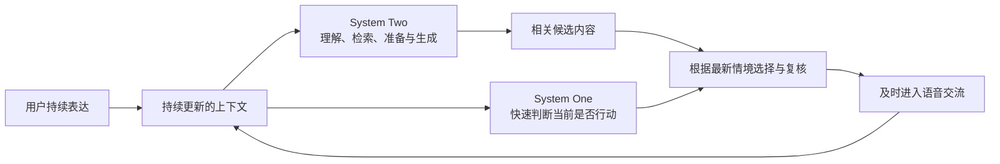

RealtimeGuide：从医药代表的临场应对，到基于上下文的实时决策
思路与产品设计草案｜供核心实现与前端视觉设计共同参考

这份草案保留产品形成的推导过程，说明我们从什么问题出发、为什么选择即时决策，以及这些判断怎样导向当前的产品形态。核心实现与前端视觉设计可以据此并行推进，具体页面、接口和字段在原型与联调中逐步形成。

一、从一次医生拜访开始理解问题

我们这次选择医疗健康赛道，首先面对的用户是准备独立拜访医生的医药代表。

代表可能已经学习了产品资料，能够介绍研究结果、回答准备过的问题。但医生拜访是一段双方共同推进的交流。医生有自己的专业问题、已有判断和时间安排，随时可能提出追问、要求澄清或改变关注重点。

例如，在一个假设的演练中：

医生已经询问研究结论适用于哪些情况。代表开始介绍研究结果，却迟迟没有回应适用范围。医生在代表说话途中再次追问，要求先回答自己的问题。

代表此时需要停止原来的表达，听清对方关切，选择相关信息，重新组织回应。如果继续背诵原来的介绍，即使内容本身没有明显错误，也可能无法完成这次沟通。

这里的训练目标应当落在准确、相关、专业的学术沟通上。医生的追问可能完全合理，代表需要理解并回应，不能把“讲完准备稿”作为唯一成功标准。中国现行规定也将医药代表定位为从事药品学术推广的专业人员。职业定位与行为要求

二、由任务要求，推导出我们关心的能力差距

这段交流包含两类不同的能力。

一类是掌握资料：知道有哪些信息、能够解释什么结论、理解相关条件与边界。

另一类是在交流发生时调用这些知识：听懂眼前的问题，判断哪些信息现在有用，并随着对方反应调整表达。

我们已经确定的痛点，是这两者之间的差距。

当代表在说话途中被打断，他需要连续完成一组动作：

停止原计划 → 听懂新问题 → 必要时澄清 → 重新选择信息 → 组织回应 → 根据对方反应继续调整。

这些动作需要在实际交流中完成。安静地读过一遍应对技巧，或者在完整问题出现后慢慢组织答案，并没有覆盖同样的任务要求。

因此，我们将首个训练片段聚焦到：已经具备基础知识的新人，在医生突然追问或改变话题时，能否理解变化并调整回应。

“打断”让这项能力变得具体、可体验、可观察，也适合作为黑客松 Demo 的主线。

三、由能力差距，推导训练环境应该具备什么

如果要练习临场调整，训练环境就需要允许对话在用户准备之外发生变化。

严格按完整轮次进行的问答，可以帮助用户练习回答内容。但用户总能先讲完自己准备的话，再处理下一道问题，练习就缺少了“表达正在进行时被改变”的那一部分。

加入打断以后，用户有机会练习停止、倾听和切换。不过，打断发生的依据还会影响训练内容。

如果打断只出现在预定时刻，用户主要练习的是承受突然变化。如果医生根据用户刚刚表达的内容产生疑问，用户还需要理解一个具体关系：

我说了什么，为什么对方此刻会这样反应，以及我应该怎样调整。

我们希望模拟环境具备这种联系。

用户回应了关切，医生可以继续听；用户忽略了问题，医生可能再次追问；用户自行修正，原本准备提出的问题可能已经没有必要。

这样，用户的行动会持续影响训练环境。练习要求他关注眼前的交流，而不能只依靠固定讲稿。

四、现有方案给我们的启发，以及我们选择深入的部分

公开的医药培训案例已经采用医生角色、常见质疑、专业资料和针对性反馈，帮助代表增加练习机会。ZS 的客户案例明确提到，人工陪练占用经理和同事时间，代表需要练习回应医生质疑。ZS 药企培训案例

市场上也已经出现不同形式的打断：
- 有些训练配置会在开场、核心介绍或收尾等阶段安排打断；
- 有些语音能力支持用户随时打断 AI；
- 有些模拟实现已经会读取部分转写、角色和对话历史，判断是否主动打断。
例如，Outdoo 的材料介绍了指定阶段的打断练习；DeepEval 的开源模拟器则已经使用上下文和部分转写作出判断。阶段配置示例、上下文打断机制

所以，我们要深入的方向是：将高频、范围明确的语义判断交给专门的快速决策层，并让它与复杂理解和生成并行协作，使动作能够跟上当前交流。

对只按轮次应答或预设节点触发的方案，我们关注实时内容怎样改变动作；对已经使用语义判断的方案，我们进一步关注判断与生成怎样分工、如何异步准备，以及动作是否仍然适用于最新情境。

这是我们选择的核心设计方向，也应当是技术研究与 Demo 展示的重点。

五、“即时性”具体指什么

这里的即时性，需要同时包含三个方面。

第一，依据当前语义。
系统要理解用户正在表达的意思，判断内容与当前问题的关系。只看说话时长、音量或固定关键词，难以承担这项工作。

第二，使用已有上下文。
同一句介绍，在不同情境下可能需要不同反应。

医生正在了解研究结果时，介绍结果可能合适；医生已经要求说明适用范围，而代表仍持续介绍结果时，就可能需要追问。动作取决于当前表达与前文关切之间的关系。

第三，赶上有效时机。
判断即使合理，等到用户已经换了话题、回答了问题以后才执行，也会成为过时的干预。

因此，系统需要持续更新判断。用户说到足够形成判断的语义片段后，系统才能决定是否行动；在行动真正发生之前，也需要关注情况有没有变化。

我们希望呈现的是：系统能够依据正在发生的信息，及时决定现在该做什么。

六、为什么引入 System One

许多实时场景都包含大量小判断：
- 当前表达是否回应了对方关切；
- 是否出现值得澄清的内容；
- 原先的问题是否已经解决；
- 此刻应该继续听，还是发起追问；
- 已经准备的回应是否仍然适用。
如果每次判断都需要同时生成完整理由和长段回复，系统就容易把决定行动的时机，与复杂内容生成绑定在一起。

我们引入 System One，正是希望专门处理这类高频、范围明确的判断。

Jev-like 决策模型是候选技术方向：输入当前状态与明确问题，直接返回结构化判断；多个独立问题可以在同一次请求中并行处理。TypeSafe 模型机制、并行判断模式

我们的原创工作主要落在：
- 怎样构建适合快速判断的上下文；
- 怎样把复杂情境拆成合适的小判断；
- 怎样组合这些判断形成当前动作；
- 怎样与慢层准备的内容协作；
- 怎样在情境变化后更新或撤销动作。
模型名称本身不能替代这套设计。它提供一种适合快速决策的能力，我们要把这种能力组织成实际的实时体验。

七、为什么 System Two 必须同时工作

快速决定需要行动，还不足以让对话自然继续。

如果系统在决定打断之后，才开始理解整个问题、查询资料并生成回复，用户就可能先被打断，再面对长时间等待。这会破坏我们希望建立的即时体验。

因此，System One 与 System Two 应当并行异步运行。

用户说话时，快层持续判断当下情况；慢层已经在理解情境、使用资料、准备可能相关的追问和讨论内容。

当快层决定追问时，可以使用仍然适用、已经准备好的内容，尽快进入语音输出。慢层继续结合新交流展开讨论。

后台准备会随上下文变化。它可以准备几种可能相关的回应，但当前是否使用、使用哪一种，仍由眼前情境决定。

这也解释了提前准备与固定剧情的区别：候选是可能采取的行动，用户的实际表达决定它们是否发生。

首句追问本身应当具备明确目的。只先说一句“等等”，然后长时间等待剩余内容，无法体现这套设计的价值。

八、上下文怎样把两层接起来

两层需要共同理解同一段交流，但使用的信息范围可以不同。

快层需要足以判断当前动作的重点信息。慢层可以使用更完整的历史、专业资料、Skills 和 Memory，形成更深入的理解与内容准备。

两层都需要知道：
- 医生当前关心什么；
- 双方实际说过什么；
- 哪些问题已经得到回应；
- 哪些问题仍然需要处理；
- 用户正在朝什么方向表达；
- 当前有哪些相关资料；
- 哪些候选回应仍然有用。
上下文也是双向协作的媒介。

慢层整理出的重点、资料与讨论方向，可以帮助快层判断接下来值得关注什么。快层观察到新的语义变化，也可以让慢层更新理解和准备内容。

这里需要保留两项区别。

一项是实际发生的交流，与尚未说出口的候选内容。候选不能因为已经生成，就被当成医生已经说过的话。

另一项是准备内容时的情境，与准备完成后的当前情境。后台结果返回时，需要检查其语义依据是否仍然成立。用户只是补充了信息，候选可能仍然可用；用户已经回答原问题，追问就可能需要撤销。

这些协作关系是当前核心工作的重点。具体怎样表达、传递和保存，在实现中逐步明确。

九、两种产品模式分别服务什么目标

产品保留 Performance Mode 与 Learning Mode。

Performance Mode 侧重支持用户完成当前任务。用户需要时，可以获得适量提示、相关资料或回应策略，让眼前的练习能够继续推进。

Learning Mode 侧重独立应对与能力成长。系统留出用户尝试的机会，再围绕关键时刻复盘，并组织新的练习。

两种模式共同使用快慢两层。它们决定帮助策略与训练目标，不对应某一个模型单独运行。

这次医疗演练中，用户既可以体验有支持的练习，也可以减少帮助，再次面对相近的问题。

长期愿景是帮助用户逐渐获得能够独立调用的能力。本次黑客松展示的是这条路径怎样成为可运行的体验，后续再通过使用、观察和迭代继续发展它。

十、首个 MVP 怎样承载整条思路

首个 MVP 聚焦一个资料包、一位模拟医生和一种主要关切，把核心片段做完整。

用户准备后进入交流。医生根据代表的表达采取行动，代表理解并调整回应。结束后，用户查看关键片段，再尝试一次。

最能说明设计的三个变化是：
当前交流	模拟医生的反应	用户能理解的关系
代表持续偏离医生的问题	及时追问	表达没有回应关切，会影响对方行为
代表正在针对问题回应	继续听	恰当回应能够推进交流
代表最初偏离，随后自行调整	撤销尚未发生的追问	系统持续依据最新信息作决定

复盘再把这段关系解释清楚：医生当时为什么追问，用户听到了什么，又怎样作出了回应。重练可以先重复片段帮助调整，再改变问法或时机，让用户重新判断。

这个片段把实时理解、快速决策、深度生成、复盘和再练连接起来，也让共通技术有一个具体的体验载体。

十一、哪些工作值得投入原创时间

我们把原创时间集中在：
- System One 的判断设计；
- 实时上下文的构建与更新；
- 快慢两层的并行异步协作；
- 当前判断与候选内容的结合；
- 追问、继续听、调整和撤销怎样形成自然交流。
其他部分优先复用成熟能力：
- System Two 使用 Pi Agent 等成熟基座；
- 专业流程与资料使用 Skills 做轻量领域适配；
- 使用成熟 Memory 能力；
- 语音输入、转写、合成与基础交互使用成熟技术；
- 语调、情绪识别暂不作为首版重点。
当前先把真实链路接起来，让设计接受实际交互的检验。接口、字段、通信方式和内部组织，在接入、调试与联调中逐步形成。

十二、这套推导对前端视觉设计意味着什么

前端需要帮助用户理解和参与这段交流。具体页面可以继续探索，但呈现应当服务于以下关系。

交流能够自然发生。
用户可以表达，医生能够在有理由时追问，双方随后还能继续交流。体验应当体现对话在共同推进。

医生的行为有可理解的原因。
用户需要逐渐感受到：对方关注什么，自己的回应为什么会引发追问或推动交流。医生不必始终表现为挑错或施压的角色。

保持安静也有意义。
用户正在合适地回应时，系统继续听是一种有依据的选择。视觉呈现应允许这种安静，而不需要通过持续弹提示证明系统在工作。

打断之后能够接上内容。
用户体验到的应是一段相关的追问与交流，语音与内容的衔接需要支持这个连续过程。

复盘能回到具体经历。
反馈应当与刚刚发生的片段联系起来，让用户理解自己的选择，而不只看到一个笼统分数。

重练能让用户尝试不同做法。
用户可以带着复盘中的理解重新进入情境，观察自己的调整怎样改变对方反应。

技术解释与正常练习各有位置。
正常练习服务于用户的任务。面向评委的技术说明，可以另外呈现系统依据什么作判断、为什么此刻采取行动，帮助解释核心设计。

这些关系是视觉设计的出发点。具体布局、组件和风格，应当从原型体验中继续推导。

十三、从医疗场景走向更广的愿景

医生的突然追问、演讲中逐渐偏题、解题时进入需要指导的步骤，具体内容不同，但存在一组共同要求：

持续理解正在发生的任务，结合已有上下文，判断此刻是否需要行动，并在仍然有效的时机作出回应。

医疗拜访让我们能先把这组能力放进一个明确的专业场景。完成这个片段以后，再向外说明：快速决策层、深度理解层及其上下文协作，可以怎样支持更多即时场景。

因此，对外叙事仍然从医疗场景开始：

真实的临场应对困难 → 训练环境需要怎样的反应能力 → 语义与上下文驱动的即时决策 → 快慢两层并行协作 → 一个完整的演练体验 → 共通能力与长期愿景。

我们的长期方向，是让 AI 持续理解人的任务，在需要时提供恰当支持，并把实际经历连接到反思与练习，帮助用户从掌握知识，逐步走向能够在现实情境中独立行动。

从医药代表的临场应对,到基于上下文的实时决策。这份草案保留我们的推导过程,方便核心实现和前端视觉设计对齐思路;页面、接口和字段留到原型和联调过程中再定。我们这次从准备独立拜访医生的医药代表出发。在一次完整拜访中,医生的追问、澄清要求或关注点变化,会让代表需要停下原本的表达,听懂关切,重新选择信息并组织回应。这和“是否学过资料”是两类能力,训练重点应落在准确、相关、专业的学术沟通上,不能把“讲完准备稿”作为唯一的成功标准。这次方案的核心能力是根据正在发生的表达、已有交流和医生的关切,持续判断现在应该继续听、追问打断,还是取消已经不再适用的追问,让模拟医生的行为跟着用户当下的表达变。为此,我们建议把快慢两层并行异步写清楚:快层持续处理小判断,慢层在后台理解情境、调用资料和准备追问及后续讨论,快层决定打断时就能直接使用已经准备好的短内容,而生成长回复的工作继续进行;若用户已经调整,快慢两层共享的上下文会让过时追问撤销。我们优先把这个协作关系和复盘重练讲清楚,再让视觉围绕这些关系展开。长期再从医生追问延伸到演讲偏题、解题指导等场景,都围绕同样的共同动作:持续理解任务、结合已有上下文、判断是否行动,在有效时机支持用户从“知道”走到“能做到”。